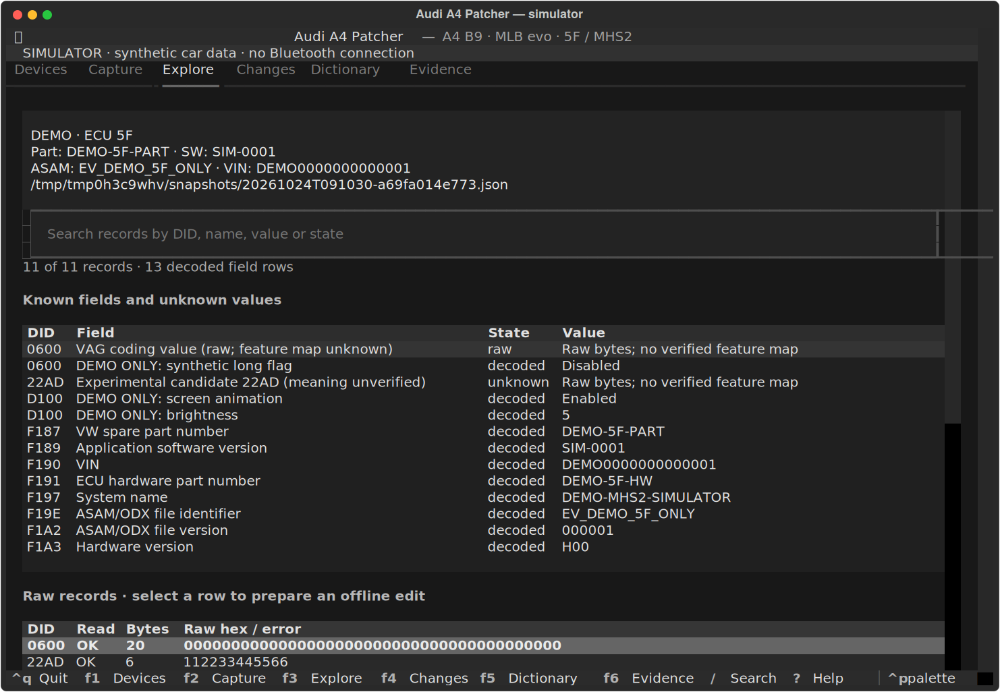

# Audi A4 Patcher

A local diagnostic workspace for **Audi A4 B9 2017 / MLB evo**, the **5F / MHS2**
infotainment unit, and the **Vgate iCar Pro 2S BLE** adapter: a
[Textual](https://textual.textualize.io/) terminal interface, a CLI, editable
JSON dictionaries and a persistent simulator. macOS, Python 3.11+, managed by uv.

**Hardware status:** the software and simulator run without a car. The adapter
and vehicle still need physical validation. Shipped live vehicle definitions are
read-only. Outgoing long-coding writes are blocked.



## Start

```bash
brew install uv
git clone https://github.com/MaksimSurmach/AudiA4Patcher.git
cd AudiA4Patcher
uv sync --locked
uv run --locked audi-a4-patcher                                  # TUI, starts at Devices
uv run --locked audi-a4-patcher --data-dir ./demo-first --demo   # simulator, no Bluetooth
```

The six sections are Devices, Capture, Explore, Changes, Dictionary and Evidence
(**F1–F6**; **/** searches, **?** opens help). Selecting a Bluetooth device does
not connect; each online operation opens the adapter and closes it afterwards.
Workflows and shortcuts: [TUI guide](docs/TUI_GUIDE.md).

To rehearse a full change on the simulator: capture **5F**, pick `demo.display`
in Dictionary, set byte `0` bit `0` to `0`, **Preview**, confirm with the exact
phrase and **Apply once**, then **Restore preview** and apply the reverse plan.
`demo.*` definitions describe invented fields and never authorize a vehicle write.

## First collection from the vehicle

Park, ignition on, close Car Scanner or any other app using the adapter, and
allow Bluetooth for the terminal in macOS privacy settings. Then scan and collect:

```bash
uv run --locked audi-a4-patcher scan
uv run --locked audi-a4-patcher --data-dir ./runs/first --device IOS-Vlink collect
```

Use the exact UUID or a unique name from the scan (on macOS the identifier is a
UUID, not a MAC address). `collect` reads **5F, 19 and 01** in separate
connections, keeps successes and errors, and writes a support ZIP under
`runs/first/exports/`. It never writes coding or adaptation values. The ZIP may
contain the VIN, serial numbers and raw traffic; nothing is uploaded.

The default read set includes identification records, raw coding `0600` and
experimental `22AD` (meaning unverified; not labeled as Apple_DIO). An
unsupported record is kept as an error, not an empty value. Extra reads:

```bash
uv run --locked audi-a4-patcher --data-dir ./runs/extra --device IOS-Vlink capture --ecu 5F --did F18C --did F17C
uv run --locked audi-a4-patcher --data-dir ./runs/extra --device IOS-Vlink capture --ecu 5F --dids-file examples/extra-dids.txt
```

A capture reads at most 256 identifiers, never sweeps unknown addresses, and is
paced. `--only` skips dictionary defaults; `--dtc` reads trouble codes without
clearing them.

## Dictionaries

Definitions live in [audi_workbench/data/default.json](audi_workbench/data/default.json)
(`audi-a4-patcher dictionary` prints them). Unknown fields stay unknown. Byte
offsets start at **0**; bit **0** is the least significant bit. Draft read-only
candidates from a real snapshot, then load the complete file:

```bash
uv run --locked audi-a4-patcher dictionary-template SNAPSHOT.json --output ./my-mhs2-dictionary.json
uv run --locked audi-a4-patcher --dictionary ./my-mhs2-dictionary.json inspect SNAPSHOT.json
```

Writable entries need an exact identity fingerprint, length, allowed-bit mask
and evidence; see the [dictionary contract](docs/DICTIONARY.md) and
[sources](docs/SOURCES.md).

## CLI

Global options (`--data-dir`, `--device`, `--demo`, `--dictionary`) go **before**
the subcommand. Output is JSON.

```bash
uv run --locked audi-a4-patcher inspect SNAPSHOT.json
uv run --locked audi-a4-patcher diff BEFORE.json AFTER.json
uv run --locked audi-a4-patcher --data-dir ./runs/first export

# Plan, apply once, restore (simulator shown; same engine as the TUI)
uv run --locked audi-a4-patcher --data-dir ./demo-cli --demo capture
uv run --locked audi-a4-patcher --data-dir ./demo-cli plan SNAPSHOT.json --entry demo.display --byte 0 --bit 0 --value 0
uv run --locked audi-a4-patcher --data-dir ./demo-cli --demo apply PLAN.json --enable-writes --confirm 'EXACT PHRASE FROM THE PLAN'
uv run --locked audi-a4-patcher --data-dir ./demo-cli restore TRANSACTION.json

# After an uncertain live result: read the actual state, never re-send
uv run --locked audi-a4-patcher --data-dir ./runs/first --device IOS-Vlink reconcile TRANSACTION.json
```

A raw `--did` plan stays blocked until an exact permitted definition is chosen.
Keep using the same data directory: unresolved `attempting`, `unknown` and
`verification_failed` receipts block new writes to the same ECU and VIN.

## Write checks and recovery limits

Every write goes through one service. It requires explicit confirmation, exact
identity and CAN addresses, a valid dictionary entry, allowed bits and enum
values, unchanged length, transport capacity, fresh current bytes, adapter
voltage 12.3–15.0 V, and zero speed and RPM. Missing data blocks the write.
Before the single `2E` request it saves and verifies a backup and durably records
the attempt, then checks the response and reads the value back. Timeouts are
kept for reconciliation; there are no automatic retries or rollbacks.

| Capability | Current boundary |
|---|---|
| Configuration snapshots | Only successfully read records; not a full 5F image |
| Restore | Reverse change of one previously modified permitted record |
| Live short writes | At most **4 value bytes** plus the 3-byte service/DID prefix |
| Long incoming responses | ISO-TP assembly with length and sequence checks |
| Long outgoing coding writes | **Blocked** |
| SecurityAccess-protected writes | Not implemented |
| CarPlay activation | No verified Apple_DIO mapping |
| Firmware/EEPROM recovery | Not implemented |

ELM327 `CAF1` permits seven UDS request bytes here, so a long `0600` value can be
read, saved and previewed but not written. Immediate matching readback means
`verified`; persistence after an ignition cycle needs another capture. Details:
[architecture](docs/ARCHITECTURE.md).

## Development

```bash
uv sync --locked --dev
uv run --locked pytest -q
uv run --locked ruff check audi_workbench tests
uv run --locked audi-a4-patcher --data-dir ./demo-check --demo collect
uv build
```

CI runs the same on Linux and macOS without a real adapter. Regenerate `uv.lock`
with `uv lock` when dependencies change. Contribution rules: [AGENTS.md](AGENTS.md).
